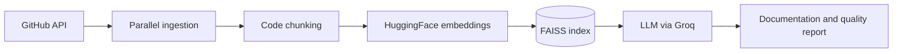
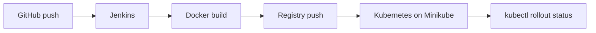

<h1 align="center">Nikita Mahindrakar</h1>

  <b>Software Engineer</b> building reliable automation and LLM-powered tools 
  Python &nbsp;·&nbsp; CI/CD &nbsp;·&nbsp; Retrieval-Augmented Generation &nbsp;·&nbsp; Observability

  <a href="https://linkedin.com/in/nikita-mahindrakar">LinkedIn</a> &nbsp;|&nbsp;
  <a href="mailto:mahindrakarnikita8@gmail.com">Email</a> &nbsp;|&nbsp;
  India

---

## About

I turn slow, manual engineering workflows into tools people can trust. During 17 months at **Siemens DISW**, I worked on a large C++ product with 5+ daily builds, where I built CI/CD pipelines, a real-time monitoring dashboard, validation tooling, and an LLM assistant that lets engineers query build data in plain English.

My approach is simple: keep the code modular, validate inputs early, ground AI answers on real data, and make failures easy to diagnose.

**Education:** B.Tech, Information Technology, Government College of Engineering, Karad (2024, CGPA 8.94 / 10)
**Certifications:** AWS Cloud Practitioner Essentials · Explainable AI and Responsible AI

## Focus Areas

| | |
|---|---|
| **LLM applications** | Prompt design, structured outputs, RAG, NL-to-SQL, grounding answers on internal data |
| **Backend and APIs** | Python services with Flask and FastAPI, REST design, input validation |
| **Delivery pipelines** | Jenkins, GitLab CI/CD, Docker, Kubernetes, automated quality gates |
| **Reliability** | Monitoring dashboards, alerting, log analysis, root cause analysis |

## Selected Work

### CodeInsight-AI: a RAG pipeline for understanding codebases

Point it at a GitHub repository and it produces documentation and flags quality issues, using an LLM grounded on the repository's own code.

- Parallel ingestion design reduced analysis latency by about **5x**
- Stack: Python, LangChain, FAISS, HuggingFace, Groq (LLaMA), GitHub API

### Minikube CI/CD Pipeline: from commit to running pod

A hands-off delivery pipeline with no manual steps, verified after every deployment.

- Stack: Jenkins, Docker, Kubernetes (Minikube), Python

### EyeWear Order Management System

A full-stack order tracking application with real-time SLA monitoring and a machine learning model that predicts order turnaround time.

- Stack: React, TypeScript, FastAPI, MongoDB Atlas, Scikit-learn

### Student Record Management System

A multithreaded client-server system with modular object-oriented design. It serves concurrent connections and keeps records synchronized in real time over WebSocket.

- Stack: C++, Boost.Asio, Boost.Beast, WebSocket, CMake

## Professional Experience

**Software Engineer Intern, Siemens DISW** · Pune · Jun 2024 to Nov 2025

- Built and maintained GitLab CI/CD and Jenkins pipelines with automated quality gates, reaching a pipeline success rate above 80% across 5+ daily builds
- Built **NXCI Bot**, an LLM assistant on LangChain and Azure OpenAI with a custom NL-to-SQL engine, so engineers can ask questions about build data in plain English
- Designed a real-time service monitoring dashboard with alerting and audit logging, and a validation tool that detects data inconsistencies across teams
- Wrote Python automation for deployment validation and environment configuration, and fixed build and pipeline defects from compiler logs and stack traces

> Siemens projects are internal, so their code is not public.

## Toolbox

**Languages:** Python · JavaScript · TypeScript · C++ · SQL
**Frameworks:** Flask · FastAPI · React · LangChain · Streamlit
**Data and AI:** MySQL · MongoDB · FAISS · HuggingFace · Scikit-learn · Azure OpenAI
**Infrastructure:** Docker · Kubernetes · Jenkins · GitLab CI/CD · AWS · Linux
**Practices:** Git · code review · Agile · technical documentation · root cause analysis

## Get in Touch

I'm interested in roles where I can build AI-assisted tooling, backend services, and delivery automation. The best way to reach me is by [email](mailto:mahindrakarnikita8@gmail.com) or on [LinkedIn](https://linkedin.com/in/nikita-mahindrakar).
